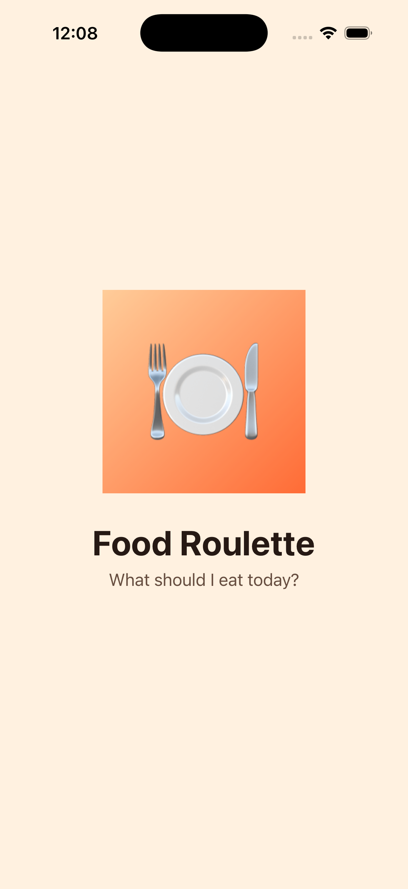
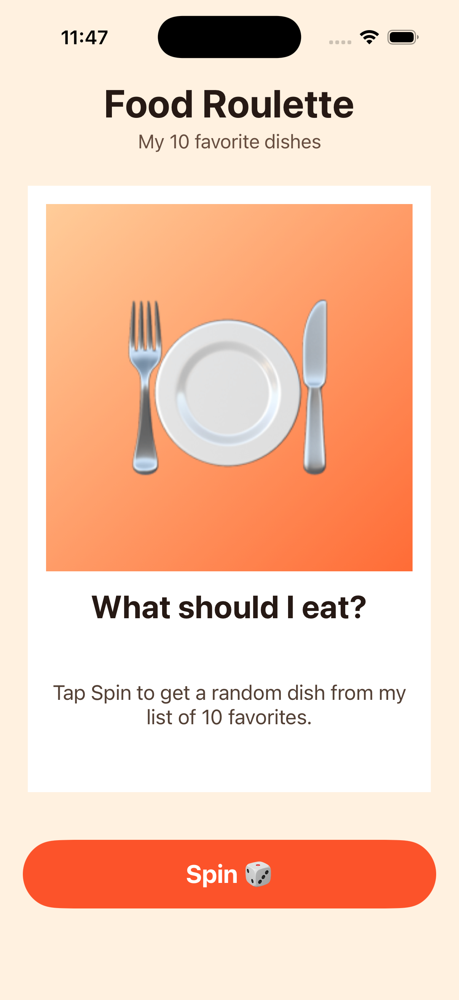
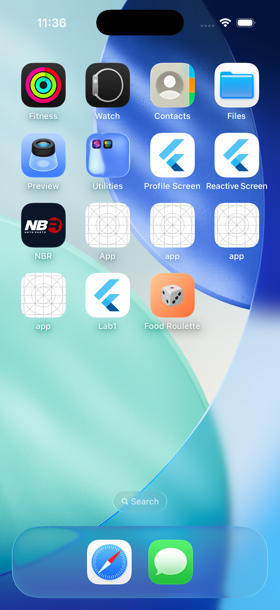

# Food Roulette

Lab 6 · Favorites Roulette. A single-screen iOS app (UIKit, Storyboard, Swift) that shows a random card from my 10 favorite dishes. Each tap on **Spin** shows a new dish, never the same one twice in a row.

- Layout is built in `Main.storyboard` without Auto Layout (no constraints)
- Favorites are stored as an array of the `Favorite` struct in `ViewController.swift`
- Images, the launch screen and the app icon are in `Assets.xcassets` / `LaunchScreen.storyboard`

## Screenshots

| Launch screen | Main screen | Home Screen |
|---|---|---|
|  |  |  |
