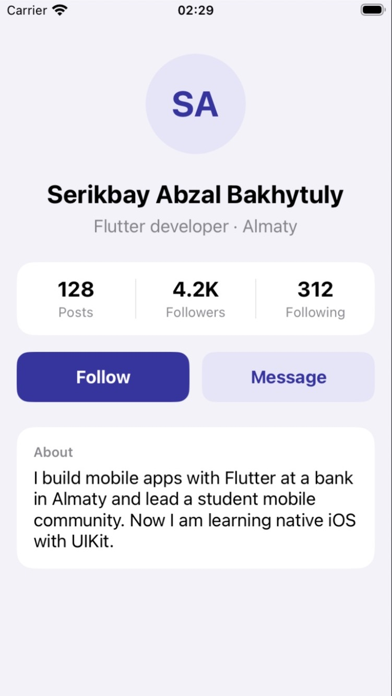
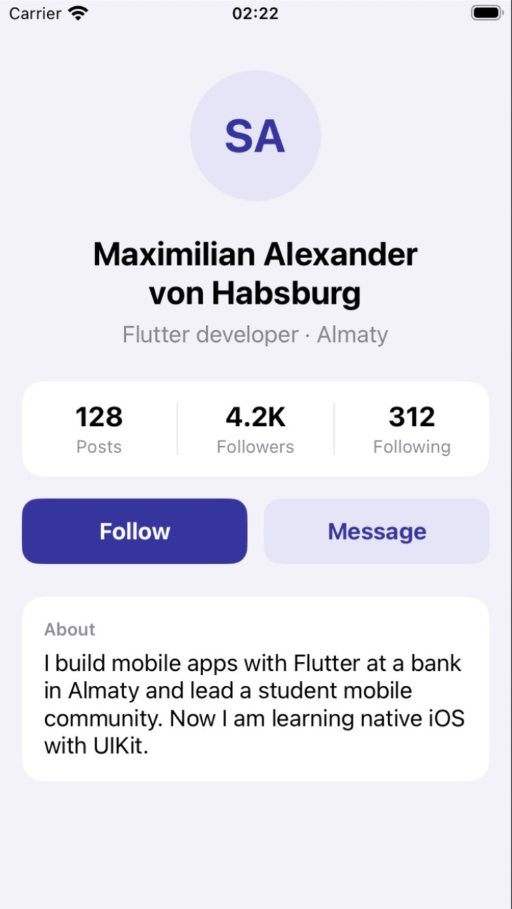
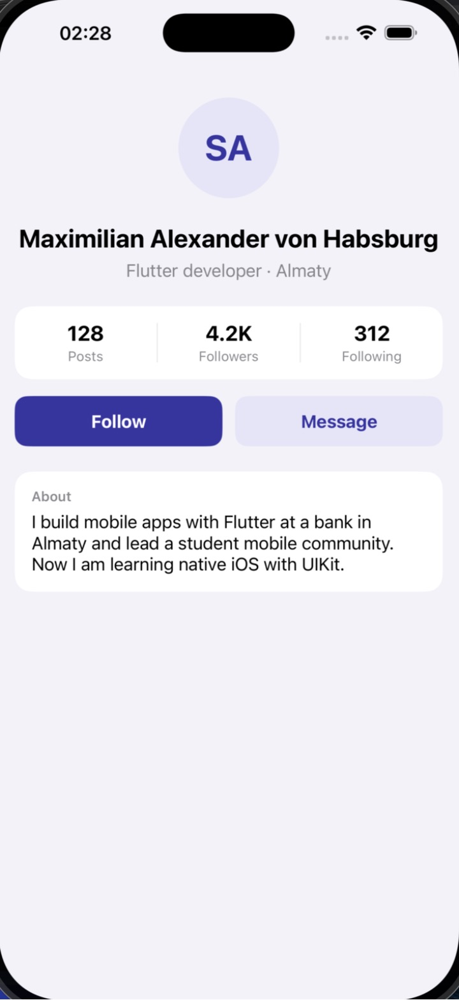

# Profile Screen

Assignment 7 · Auto Layout, Variant A (Profile). A single profile screen built in UIKit with a Storyboard only.

- Every view and constraint is set in `Main.storyboard`, without `UIStackView`
- `ViewController.swift` only fills the labels from a `Profile` struct
- Side margins are 16 pt and the content stays inside the safe area
- The three stats use Equal Widths, Follow and Message have equal widths with 12 pt between them and are 48 pt tall
- Rounded corners are set with `layer.cornerRadius` in User Defined Runtime Attributes

## Screenshots

| iPhone SE (3rd generation) | iPhone 16 Pro Max |
|---|---|
|  |  |

## Long text test

Name set to "Maximilian Alexander von Habsburg".

| iPhone SE (3rd generation) | iPhone 16 Pro Max |
|---|---|
|  |  |
