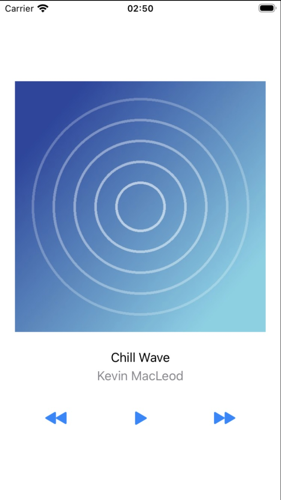
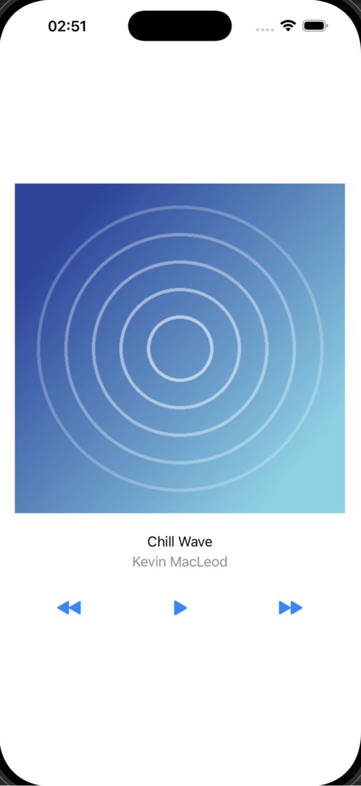

# Music Player

Lab · Music Player, UIStackView & Auto Layout. A single-screen music player in UIKit: track cover, title, artist and Previous / Play-Pause / Next buttons that play audio files from the app bundle.

- Layout is built in `Main.storyboard` with three stack views: a vertical root stack, a stack with the two labels and a horizontal stack with the controls
- The root stack is pinned to the Safe Area with 20 pt margins and centered vertically, the cover keeps a 1:1 aspect ratio
- `Track` describes one track, `TrackLibrary` keeps the list of 10 tracks
- `ViewController` plays audio with `AVAudioPlayer`, keeps the current index and play state, and starts the next track in `audioPlayerDidFinishPlaying`
- Next on the last track goes to the first one, Previous on the first track goes to the last one

## Screenshots

| iPhone SE (3rd generation) | iPhone 16 Pro Max |
|---|---|
|  |  |

## Music

All tracks are by Kevin MacLeod (incompetech.com), licensed under Creative Commons: By Attribution 4.0 (https://creativecommons.org/licenses/by/4.0/):
Chill Wave, Electrodoodle, Neon Laser Horizon, Blip Stream, Funkorama, Ether Vox, Voice Over Under, Bit Shift, Cool Vibes, Carefree.
