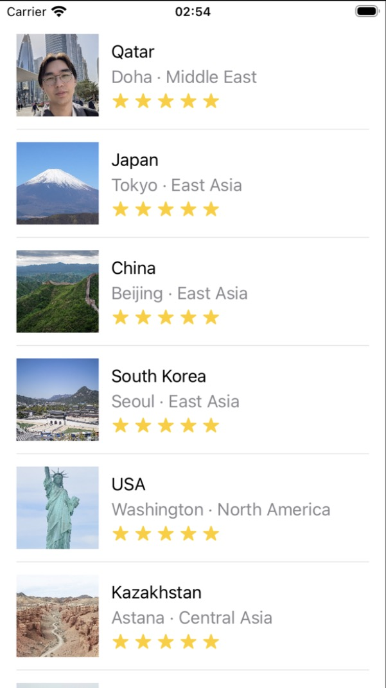
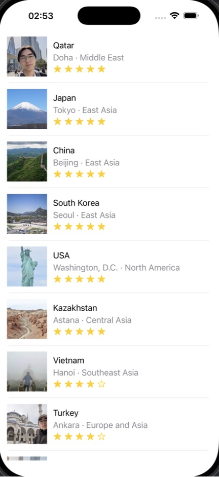

# Favorites List

Lab · Favorites List, UITableView & Custom Cells. My theme is countries: 20 countries I have visited or want to visit, each with a photo, a subtitle and a rating from 0 to 5.

- One screen with a `UITableView` that fills the Safe Area
- The cell is a prototype cell in `Main.storyboard` with the class `FavoriteCell` and the reuse identifier `FavoriteCell`
- The cell shows an 80 x 80 image, a title, a subtitle and five stars (`star.fill` / `star`)
- `FavoriteItem` describes one country, `FavoriteLibrary` keeps the array of items
- `ViewController` is the data source and dequeues cells with `dequeueReusableCell(withIdentifier:for:)`

## Screenshots

| iPhone SE (3rd generation) | iPhone 16 Pro Max |
|---|---|
|  |  |

## Photos

Qatar, Vietnam, Turkey and UAE are my own photos. The other photos are from Wikimedia Commons:

- Japan: [View_of_Mount_Fuji_from_Ōwakudani_20211202.jpg](https://commons.wikimedia.org/wiki/File:View_of_Mount_Fuji_from_%C5%8Cwakudani_20211202.jpg)
- China: [The_Great_Wall_of_China_at_Jinshanling-edit.jpg](https://commons.wikimedia.org/wiki/File:The_Great_Wall_of_China_at_Jinshanling-edit.jpg)
- South Korea: [광화문_월대.jpg](https://commons.wikimedia.org/wiki/File:%EA%B4%91%ED%99%94%EB%AC%B8_%EC%9B%94%EB%8C%80.jpg)
- USA: [Front_view_of_Statue_of_Liberty_(cropped).jpg](https://commons.wikimedia.org/wiki/File:Front_view_of_Statue_of_Liberty_%28cropped%29.jpg)
- Kazakhstan: [Charyn_Canyon,_Kazakhstan_03.jpg](https://commons.wikimedia.org/wiki/File:Charyn_Canyon%2C_Kazakhstan_03.jpg)
- Italy: [Colosseo_2020.jpg](https://commons.wikimedia.org/wiki/File:Colosseo_2020.jpg)
- Spain: [SF_maig_2_cropped.jpg](https://commons.wikimedia.org/wiki/File:SF_maig_2_cropped.jpg)
- Thailand: [เจดีย์ประธานทรงปรางค์วัดอรุณ2.jpg](https://commons.wikimedia.org/wiki/File:%E0%B9%80%E0%B8%88%E0%B8%94%E0%B8%B5%E0%B8%A2%E0%B9%8C%E0%B8%9B%E0%B8%A3%E0%B8%B0%E0%B8%98%E0%B8%B2%E0%B8%99%E0%B8%97%E0%B8%A3%E0%B8%87%E0%B8%9B%E0%B8%A3%E0%B8%B2%E0%B8%87%E0%B8%84%E0%B9%8C%E0%B8%A7%E0%B8%B1%E0%B8%94%E0%B8%AD%E0%B8%A3%E0%B8%B8%E0%B8%932.jpg)
- Singapore: [Marina_Bay_Sands_(I).jpg](https://commons.wikimedia.org/wiki/File:Marina_Bay_Sands_%28I%29.jpg)
- Switzerland: [Matterhorn_from_Domhütte_-_2.jpg](https://commons.wikimedia.org/wiki/File:Matterhorn_from_Domh%C3%BCtte_-_2.jpg)
- Georgia: [Gergeti_Trinity_Church_09.23.jpg](https://commons.wikimedia.org/wiki/File:Gergeti_Trinity_Church_09.23.jpg)
- Australia: [Sydney_Opera_House_2026.jpg](https://commons.wikimedia.org/wiki/File:Sydney_Opera_House_2026.jpg)
- France: [Mont-Saint-Michel_vu_du_ciel.jpg](https://commons.wikimedia.org/wiki/File:Mont-Saint-Michel_vu_du_ciel.jpg)
- Germany: [Brandenburger_Tor_abends.jpg](https://commons.wikimedia.org/wiki/File:Brandenburger_Tor_abends.jpg)
- Uzbekistan: [RegistanSquare_Samarkand.jpg](https://commons.wikimedia.org/wiki/File:RegistanSquare_Samarkand.jpg)
- Malaysia: [Batu_Caves_stairs_2022-05.jpg](https://commons.wikimedia.org/wiki/File:Batu_Caves_stairs_2022-05.jpg)
