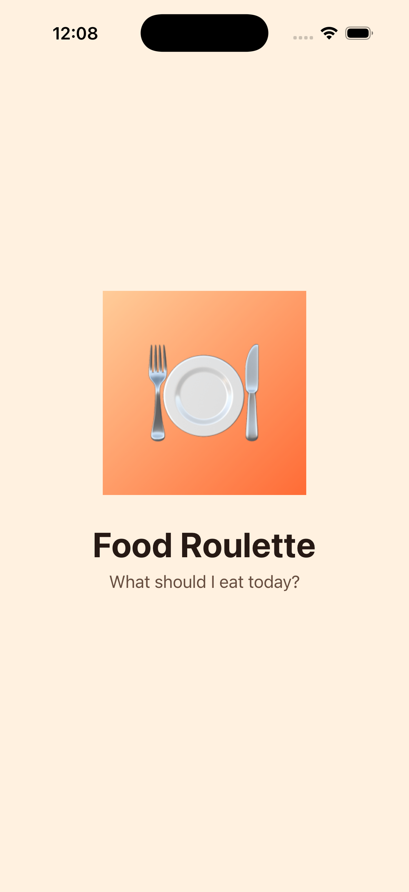
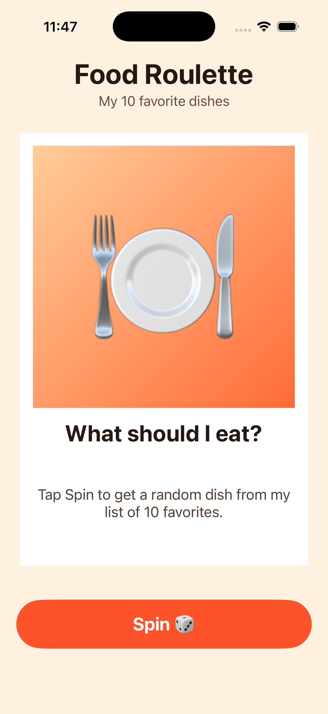
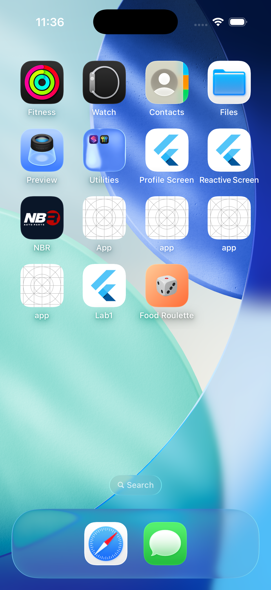

# iOS Course


Coursework for an iOS development course at university: six assignments that go from Swift basics in Playgrounds to a first UIKit app built with Storyboards.

## Assignments

| # | Format | Topic |
|---|--------|-------|
| 1 | Playground | Constants, variables and basic types, string interpolation |
| 2 | Playground | Collections: arrays, sets and dictionaries |
| 3 | Playground | Functions, closures, tuples and classes, in a multi-level space-station scenario |
| 4 | Playground | Enums with associated values, value semantics (`struct`, `inout`), error-prone data parsing |
| 5 | Playground | Class inheritance, protocols, protocol extensions and polymorphism |
| 6 | Xcode project | **Favorites Roulette**: UIKit app with a Storyboard UI |

## Assignment 6: Favorites Roulette

A single-screen app that shows a random card from 10 favorite dishes. Each tap on **Spin** picks a new dish, never the same one twice in a row.

- Layout is built in `Main.storyboard` without Auto Layout constraints
- Data is an array of a `Favorite` struct, wired to the UI through `@IBOutlet` / `@IBAction`
- Images, launch screen and app icon live in `Assets.xcassets` / `LaunchScreen.storyboard`

<p>
  
  
  
</p>

## Structure

```
ios_course/
├── Assignment1.playground ... Assignment5.playground
└── Assignment6/
    ├── Assignment6.xcodeproj
    ├── FavoritesRoulette/   # ViewController, storyboards, assets
    └── Screenshots/
```

## Getting started

1. Clone the repo and open it in Xcode.
2. For assignments 1-5, open the matching `.playground` file and run it.
3. For assignment 6, open `Assignment6/Assignment6.xcodeproj`, pick a simulator and press Run.
